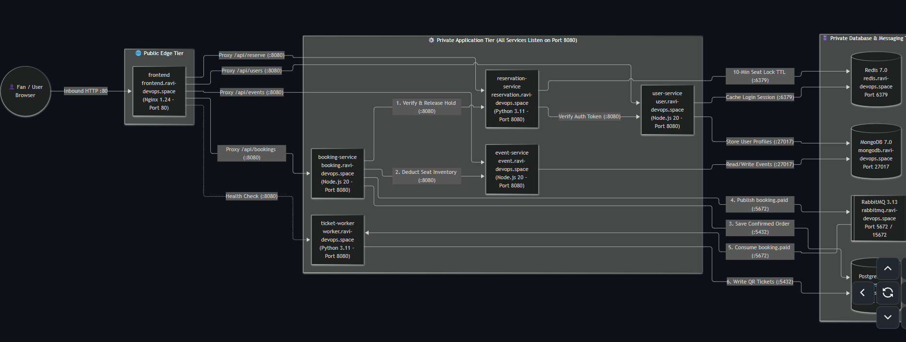
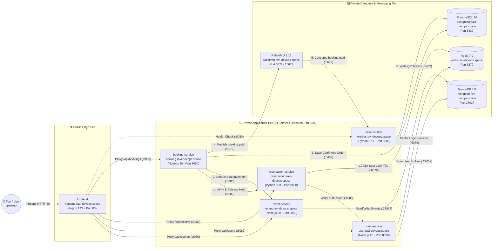
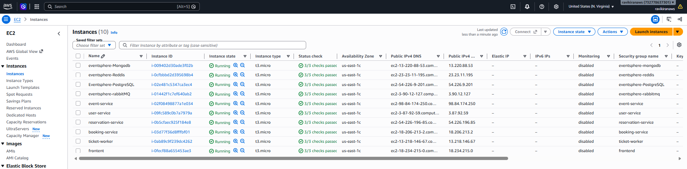
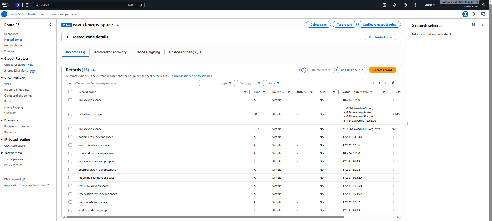
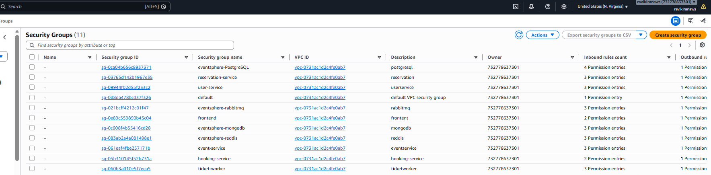
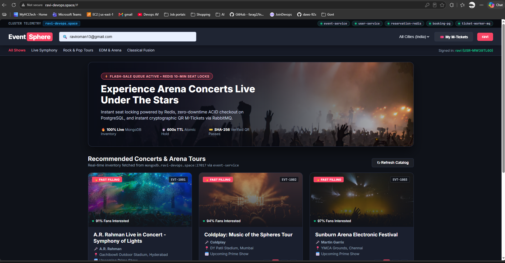
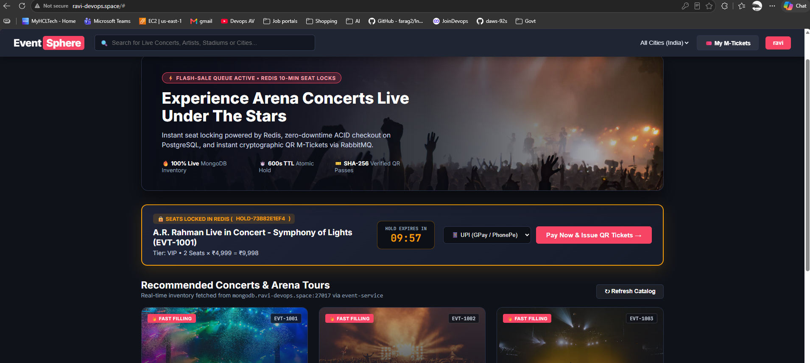
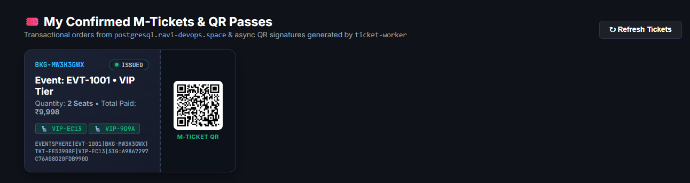

# 🎟️ EventSphere — Distributed Concert Ticketing Microservices Platform

**Live Domain:** `http://ravi-devops.space` | **Cloud:** AWS EC2 (`us-east-1`) & Route 53 | **OS:** RHEL 9 / AlmaLinux 9

EventSphere is a **BookMyShow-style flash-sale concert ticketing platform** deployed across a **10-server distributed microservices architecture** on AWS. 

Instead of running the entire application on a single monolithic server that crashes during high-traffic concert ticket drops, EventSphere decouples the frontend, business logic, caching, message queuing, and databases across **10 dedicated EC2 instances** communicating over a private AWS VPC network.

---

## 🌟 How EventSphere Works (In Simple Layman Terms)

Imagine thousands of fans trying to book tickets for **A.R. Rahman Live in Concert** at the exact same second. Here is how our 10 servers handle the rush without double-booking seats or slowing down:

1. **The Entrance Gate (`frontend` — Nginx 1.24):** 
   When a fan opens `http://ravi-devops.space`, their browser only talks to the **Frontend Server** on Port `80`. None of the backend services or databases are exposed to the public internet—Nginx acts as a reverse proxy that forwards `/api/*` requests safely inside our private AWS network.
2. **The Concert Catalog (`event-service` + `MongoDB 7.0`):** 
   Displays live concerts (`EVT-1001`, `EVT-1002`, `EVT-1003`), stadium venues, seating tiers (`VIP`, `GOLD`, `SILVER`), pricing, and real-time remaining seat counts fetched from MongoDB.
3. **The Fan Account Desk (`user-service` + `MongoDB 7.0` + `Redis 7.0`):** 
   Manages user registration and password hashing (`bcrypt`). Upon login (e.g., user `USR-MW3BTL60`), it caches an active session token in **Redis memory** so other microservices can verify the user in sub-milliseconds.
4. **The 10-Minute Seat Lock (`reservation-service` + `Redis 7.0`):** 
   When a fan selects seats (such as 2 VIP seats for ₹9,998), `reservation-service` creates an atomic lock in **Redis** (e.g., `HOLD-73BB2E1EF4`) with a strict **600-second countdown timer (`TTL`)**. If payment is not completed within 10 minutes, Redis automatically expires the lock and releases the seats back to the public pool.
5. **The Checkout Cashier (`booking-service` + `PostgreSQL 16` + `RabbitMQ 3.13`):** 
   When the user clicks **"Pay Now"**, `booking-service` verifies the Redis hold is still active, permanently deducts the seats in `event-service`, writes an ACID order record (`BKG-MW3K3GWX`) into **PostgreSQL**, clears the temporary hold, and publishes a `booking.paid` event to **RabbitMQ**.
6. **The Background Ticket Printer (`ticket-worker` + `RabbitMQ 3.13` + `PostgreSQL 16`):** 
   `ticket-worker` consumes the `booking.paid` message asynchronously from **RabbitMQ**, assigns individual seat numbers (`VIP-EC13`, `VIP-9D9A`), generates a tamper-proof **SHA-256 QR signature**, writes the tickets to PostgreSQL, and updates the booking status to **`ISSUED`**.

---

## 🏗️ Complete Architecture Diagram (Inbound & Outbound Traffic Flow)

---

## 🔄 10-Server Inventory, DNS Mapping & Port Matrix

| # | Server Name | Route 53 DNS (`ravi-devops.space`) | VPC IP / Routing | Stack & Runtime | Inbound Port | Outbound Connections |
| :- | :--- | :--- | :--- | :--- | :--- | :--- |
| **01** | `eventsphere-Mongodb` | `mongodb.ravi-devops.space` | `172.31.20.231` | MongoDB `7.0` | `27017` | None *(NoSQL Store)* |
| **02** | `eventsphere-Reddis` | `redis.ravi-devops.space` | `172.31.21.238` | Redis `7.0` | `6379` | None *(In-Memory Cache)* |
| **03** | `Eventsphere-PostgreSQL` | `postgresql.ravi-devops.space` | `172.31.25.28` | PostgreSQL `16` | `5432` | None *(ACID SQL Ledger)* |
| **04** | `eventsphere-rabbitMQ` | `rabbitmq.ravi-devops.space` | `172.31.16.129` | RabbitMQ `3.13` | `5672`, `15672` | None *(AMQP Broker)* |
| **05** | `event-service` | `event.ravi-devops.space` | `172.31.22.86` | Node.js `20` (Express) | `8080` | `mongodb:27017` |
| **06** | `user-service` | `user.ravi-devops.space` | `172.31.27.52` | Node.js `20` (Express) | `8080` | `mongodb:27017`, `redis:6379` |
| **07** | `reservation-service` | `reservation.ravi-devops.space` | `172.31.25.167` | Python `3.11` (FastAPI) | `8080` | `redis:6379`, `user:8080` |
| **08** | `booking-service` | `booking.ravi-devops.space` | `172.31.24.244` | Node.js `20` (Express) | `8080` | `reservation:8080`, `event:8080`, `postgresql:5432`, `rabbitmq:5672` |
| **09** | `ticket-worker` | `worker.ravi-devops.space` | `172.31.28.33` | Python `3.11` (Pika) | `8080` | `rabbitmq:5672`, `postgresql:5432` |
| **10** | `frontend` | `ravi-devops.space` / `frontend` | `18.234.215.0` | Nginx `1.24` + SPA | `80` | `event:8080`, `user:8080`, `reservation:8080`, `booking:8080`, `worker:8080` |

---

## 📸 Live AWS Infrastructure & Application Walkthrough

### 1. 10-Instance Distributed EC2 Cluster (`us-east-1c`)
All 10 `t3.micro` RHEL 9 instances (`eventsphere-Mongodb`, `eventsphere-Reddis`, `Eventsphere-PostgreSQL`, `eventsphere-rabbitMQ`, `event-service`, `user-service`, `reservation-service`, `booking-service`, `ticket-worker`, and `frontent`) running in `us-east-1c` with **`3/3 status checks passed`**.

---

### 2. AWS Route 53 Private & Public DNS Resolution (`ravi-devops.space`)
Instead of hardcoding IP addresses that change when servers restart, Route 53 maps `ravi-devops.space` (`18.234.215.0`) to the public Nginx gateway while routing all 9 backend and database subdomains (`*.ravi-devops.space`) across internal VPC private IPs (`172.31.x.x`) with a `1-second TTL`.

---

### 3. Granular AWS Security Group Isolation (`vpc-0731ac1d2c4fe0ab7`)
Every server tier is protected by its own dedicated Security Group (`eventsphere-PostgreSQL`, `reservation-service`, `user-service`, `eventsphere-rabbitmq`, `frontend`, `eventsphere-mongodb`, `eventsphere-reddis`, `event-service`, `booking-service`, `ticket-worker`), restricting inbound traffic strictly to required microservice ports.

---

### 4. Live EventSphere Portal, Cluster Telemetry & Redis Auth Session
Opening `http://ravi-devops.space` displays real-time health checks across all 5 backend services (`event-service`, `user-service`, `reservation-redis`, `booking-pg`, `ticket-worker-mq` all green), active user session **`ravi (USR-MW3BTL60)`** cached in Redis, and live concert inventory fetched from MongoDB (`EVT-1001` *A.R. Rahman*, `EVT-1002` *Coldplay*, `EVT-1003` *Sunburn Arena*).

---

### 5. Flash-Sale 10-Minute Atomic Seat Lock in Redis (`HOLD-73BB2E1EF4`)
Selecting 2 VIP seats for **A.R. Rahman Live in Concert - Symphony of Lights (`EVT-1001`)** triggers `reservation-service` to lock the seats in Redis (`HOLD-73BB2E1EF4`, `Tier: VIP • 2 Seats × ₹4,999 = ₹9,998`) with a live **`09:57`** countdown timer and UPI (`GPay / PhonePe`) checkout option.

---

### 6. Transactional PostgreSQL Order & Async RabbitMQ QR M-Ticket (`BKG-MW3K3GWX`)
Upon clicking **Pay Now**, `booking-service` commits order **`BKG-MW3K3GWX`** (`2 Seats • ₹9,998`) to PostgreSQL and publishes a `booking.paid` event to RabbitMQ. The Python `ticket-worker` consumes the message asynchronously, issues VIP seats **`VIP-EC13`** and **`VIP-9D9A`**, generates the SHA-256 cryptographic signature (`EVENTSPHERE|EVT-1001|BKG-MW3K3GWX|TKT-FE53908F|VIP-EC13|SIG:A9867297C76A08D20FDB990D`), updates the status to **`ISSUED`**, and renders the scannable M-Ticket QR code.

---

## 📂 Repository Structure & Step-by-Step Deployment Guides

1. [01. MongoDB 7.0 (`mongodb.ravi-devops.space`)](./Database-Messaging/MongoDB/Mongodb.md)
2. [02. Redis 7.0 (`redis.ravi-devops.space`)](./Database-Messaging/Redis/Redis.md)
3. [03. PostgreSQL 16 (`postgresql.ravi-devops.space`)](./Database-Messaging/PostgreSQL/Postgresql.md)
4. [04. RabbitMQ 3.13 (`rabbitmq.ravi-devops.space`)](./Database-Messaging/RabbitMQ/RabbitMQ.md)
5. [05. Event Service (`event.ravi-devops.space`)](./Services/event-service/event-service.md)
6. [06. User Service (`user.ravi-devops.space`)](./Services/user-service/user-service.md)
7. [07. Reservation Service (`reservation.ravi-devops.space`)](./Services/reservation-service/reservation-service.md)
8. [08. Booking Service (`booking.ravi-devops.space`)](./Services/booking-service/)
9. [09. Ticket Worker (`worker.ravi-devops.space`)](./Services/ticket-worker/ticket-worker.md)
10. [10. Frontend Nginx Gateway (`frontend.ravi-devops.space`)](./frontend/)

---

## 👨‍💻 Author

**Bommali Ravi Kiran**  
*Cloud & DevOps Engineer*  
* **GitHub:** [ravikran14-b](https://github.com/ravikran14-b)
* **Domain:** `ravi-devops.space`
