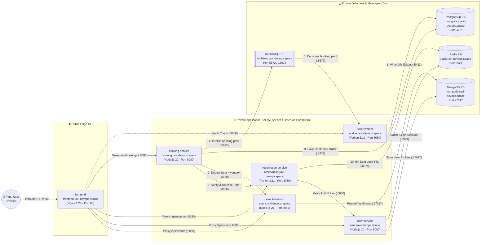

# 🎟️ EventSphere — Distributed Concert Ticketing Microservices Platform

**Domain:** `ravi-devops.space` | **Cloud:** AWS EC2 & Route53 | **OS:** RHEL 9 / AlmaLinux 9

EventSphere is a **BookMyShow-style flash-sale concert ticketing platform** built on a **10-server distributed microservices architecture** on AWS. 

Instead of running the entire website on a single server (which crashes when thousands of fans rush to buy concert tickets at the same time), EventSphere splits the workload across **10 specialized servers** communicating over a private AWS network.

---

## 🌟 How EventSphere Works (In Simple Layman Terms)

Imagine 50,000 fans trying to buy tickets for an **A.R. Rahman Live Concert** at 12:00 PM sharp. Here is how our 10 servers work together like a real stadium box office:

1. **The Entrance Gate (`frontend` — Nginx):** 
   When you open `http://ravi-devops.space` on your phone or laptop, you only talk to the **Frontend Server** on Port `80`. For security, none of our backend servers or databases are exposed to the public internet—Nginx acts as a receptionist that forwards your requests safely inside our private AWS network.
2. **The Concert Brochure (`event-service` + `MongoDB`):** 
   Shows you all upcoming concerts, stadium venues, seating tiers (`VIP`, `GOLD`, `SILVER`), prices, and how many seats are currently left.
3. **The Membership Desk (`user-service` + `MongoDB` + `Redis`):** 
   Handles account sign-ups and logins. Once you log in, it saves a fast "wristband pass" (session token) in **Redis memory** so you don't have to log in again on every click.
4. **The 10-Minute Seat Hold (`reservation-service` + `Redis`):** 
   Have you ever noticed on BookMyShow that once you pick your seats, you get **10 minutes** to complete payment so nobody else steals your seats? Our `reservation-service` locks your chosen seats in **Redis** with a strict **600-second self-destruct timer (`TTL`)**. If you don't pay within 10 minutes, Redis automatically deletes the lock and gives the seats back to other fans!
5. **The Cashier (`booking-service` + `PostgreSQL` + `RabbitMQ`):** 
   When you click **"Pay Now"**, the `booking-service` double-checks that your 10-minute seat lock is still active, permanently deducts the seats from `event-service`, writes your payment receipt into **PostgreSQL** (a strict banking-grade SQL database), and drops a note into **RabbitMQ** saying *"Order Paid—Please print QR tickets!"*
6. **The Ticket Printer (`ticket-worker` + `RabbitMQ` + `PostgreSQL`):** 
   Generating cryptographic QR codes for multiple seats takes extra computing work. Instead of making the user wait on a spinning loading screen, `ticket-worker` picks up the note from **RabbitMQ** in the background, generates tamper-proof SHA-256 QR codes for each seat, and saves them to **PostgreSQL** so your digital M-Ticket appears on screen.

---

## 🏗️ Complete Architecture Diagram (Inbound & Outbound Flow)

> *GitHub automatically renders the vector diagram below with exact Inbound and Outbound arrows:*



---

## 🔄 Inbound vs. Outbound Network & Port Matrix (10 Servers)

Every server follows strict **Least-Privilege Security Group Rules**—only required ports are opened between specific servers:

| # | Server Name | Private DNS (`ravi-devops.space`) | Tech Stack | Inbound Traffic Allowed (Who Calls It?) | Outbound Traffic Made (Who Does It Call?) |
| :- | :--- | :--- | :--- | :--- | :--- |
| **01** | **MongoDB** | `mongodb.ravi-devops.space` | MongoDB `7.0` | **Port `27017`** from `event-service` & `user-service` | None *(Database Responder)* |
| **02** | **Redis** | `redis.ravi-devops.space` | Redis `7.0` | **Port `6379`** from `user-service` & `reservation-service` | None *(In-Memory Cache Responder)* |
| **03** | **PostgreSQL** | `postgresql.ravi-devops.space` | PostgreSQL `16` | **Port `5432`** from `booking-service` & `ticket-worker` | None *(SQL Ledger Responder)* |
| **04** | **RabbitMQ** | `rabbitmq.ravi-devops.space` | RabbitMQ `3.13` | **Port `5672`** from `booking-service` & `ticket-worker`<br>**Port `15672`** from Admin IP | None *(Message Broker)* |
| **05** | **Event Service** | `event.ravi-devops.space` | Node.js `20` (Express) | **Port `8080`** from `frontend` & `booking-service` | **Port `27017`** $\rightarrow$ `mongodb` |
| **06** | **User Service** | `user.ravi-devops.space` | Node.js `20` (Express) | **Port `8080`** from `frontend` & `reservation-service` | **Port `27017`** $\rightarrow$ `mongodb`<br>**Port `6379`** $\rightarrow$ `redis` |
| **07** | **Reservation Service** | `reservation.ravi-devops.space` | Python `3.11` (FastAPI) | **Port `8080`** from `frontend` & `booking-service` | **Port `6379`** $\rightarrow$ `redis`<br>**Port `8080`** $\rightarrow$ `user-service` |
| **08** | **Booking Service** | `booking.ravi-devops.space` | Node.js `20` (Express) | **Port `8080`** from `frontend` | **Port `8080`** $\rightarrow$ `reservation-service`<br>**Port `8080`** $\rightarrow$ `event-service`<br>**Port `5432`** $\rightarrow$ `postgresql`<br>**Port `5672`** $\rightarrow$ `rabbitmq` |
| **09** | **Ticket Worker** | `worker.ravi-devops.space` | Python `3.11` (Pika/FastAPI) | **Port `8080`** from `frontend` *(Health Check)* | **Port `5672`** $\rightarrow$ `rabbitmq`<br>**Port `5432`** $\rightarrow$ `postgresql` |
| **10** | **Frontend** | `frontend.ravi-devops.space` | Nginx `1.24` + HTML5/JS | **Port `80` / `443`** from `0.0.0.0/0` *(Public Users)* | **Port `8080`** $\rightarrow$ `event`, `user`, `reservation`, `booking`, `worker` |

---

## 📂 Repository Structure & Step-by-Step Deployment Guides

Click any service below to view its source code and step-by-step RHEL 9 server configuration guide:

```text
EventSphere/
├── Database-Messaging/
│   ├── MongoDB/
│   │   ├── Mongodb.md               # 01. MongoDB 7.0 Setup Guide
│   │   ├── Master-data.js           # Seed script for live concerts & seating tiers
│   │   └── mongo.repo               # Official MongoDB 7.0 YUM repository
│   ├── Redis/
│   │   └── Redis.md                 # 02. Redis 7.0 Setup Guide
│   ├── PostgreSQL/
│   │   ├── Postgresql.md            # 03. PostgreSQL 16 Setup Guide
│   │   └── init-bookings.sql        # ACID schema for bookings & QR tickets tables
│   └── RabbitMQ/
│       └── RabbitMQ.md              # 04. RabbitMQ 3.13 Message Broker Setup Guide
│
├── Services/
│   ├── event-service/
│   │   ├── event-service.md         # 05. Event Service Setup Guide (Node.js 20)
│   │   ├── package.json
│   │   ├── server.js
│   │   └── .env.example
│   ├── user-service/
│   │   ├── user-service.md          # 06. User Service Setup Guide (Node.js 20)
│   │   ├── package.json
│   │   ├── server.js
│   │   └── .env.example
│   ├── reservation-service/
│   │   ├── reservation-service.md   # 07. Reservation Service Setup Guide (Python 3.11)
│   │   ├── requirements.txt
│   │   ├── main.py
│   │   └── .env.example
│   ├── booking-service/
│   │   ├── booking-service.md       # 08. Booking Service Setup Guide (Node.js 20)
│   │   ├── package.json
│   │   ├── server.js
│   │   └── .env.example
│   └── ticket-worker/
│       ├── ticket-worker.md         # 09. Ticket Worker Setup Guide (Python 3.11)
│       ├── requirements.txt
│       ├── worker.py
│       └── .env.example
│
├── frontend/
│   ├── frontend.md                  # 10. Nginx 1.24 Reverse Proxy & UI Setup Guide
│   ├── nginx.conf                   # Dynamic VPC DNS Reverse Proxy Config
│   └── index.html                   # BookMyShow-Style Single Page Application
│
├── load balancer/                   # AWS ALB / Traffic Routing Documentation
└── README.md                        # Project Overview & Architecture Documentation
```

### 🔗 Quick Links to Server Setup Documentation
1. [01. MongoDB (`mongodb.ravi-devops.space`)](./Database-Messaging/MongoDB/Mongodb.md)
2. [02. Redis (`redis.ravi-devops.space`)](./Database-Messaging/Redis/Redis.md)
3. [03. PostgreSQL (`postgresql.ravi-devops.space`)](./Database-Messaging/PostgreSQL/Postgresql.md)
4. [04. RabbitMQ (`rabbitmq.ravi-devops.space`)](./Database-Messaging/RabbitMQ/RabbitMQ.md)
5. [05. Event Service (`event.ravi-devops.space`)](./Services/event-service/event-service.md)
6. [06. User Service (`user.ravi-devops.space`)](./Services/user-service/user-service.md)
7. [07. Reservation Service (`reservation.ravi-devops.space`)](./Services/reservation-service/reservation-service.md)
8. [08. Booking Service (`booking.ravi-devops.space`)](./Services/booking-service/)
9. [09. Ticket Worker (`worker.ravi-devops.space`)](./Services/ticket-worker/ticket-worker.md)
10. [10. Frontend (`frontend.ravi-devops.space`)](./frontend/)

---

## 📸 AWS Infrastructure & Live Application Screenshots

### 1. 10-Instance AWS EC2 Cluster Running on RHEL 9


### 2. AWS Route53 Private & Public DNS Records (`ravi-devops.space`)


### 3. AWS Security Group Port Isolation


### 4. BookMyShow-Style Frontend & Live Cluster Telemetry


### 5. Atomic 10-Minute Seat Lock in Redis (`TTL` Countdown)


### 6. Confirmed Booking & Asynchronous SHA-256 QR M-Ticket


---

## 🛠️ Key DevOps & Production Engineering Highlights

* **Process Isolation & Least Privilege:** Every application microservice runs under a dedicated non-login system account (`eventsphere` with `/sbin/nologin`) inside `/app`, managed as a `systemd` daemon with automatic crash recovery (`Restart=always`).
* **Zero Startup Crash DNS Resolution:** Nginx is configured with the AWS VPC internal DNS resolver (`169.254.169.253 valid=10s`) and dynamic upstream variables so the web server never fails on boot if a backend microservice is restarting.
* **Database Ownership by Microservice:** Schema migrations and seed data (`Master-data.js` for MongoDB and `init-bookings.sql` for PostgreSQL) are loaded remotely over the network by the owning microservice (`event-service` and `booking-service`), validating network paths and credentials during deployment.
* **Full Observability:** Every service (including the background `ticket-worker`) exposes a live `/health` readiness probe on port `8080` that pings its underlying database/queue before reporting `"UP"` to the frontend telemetry bar.

---

## 👨‍💻 Author

**Bommali Ravi Kiran**  
*Cloud & DevOps Engineer*  
* **GitHub:** [ravikran14-b](https://github.com/ravikran14-b)
* **Project Domain:** `ravi-devops.space`
